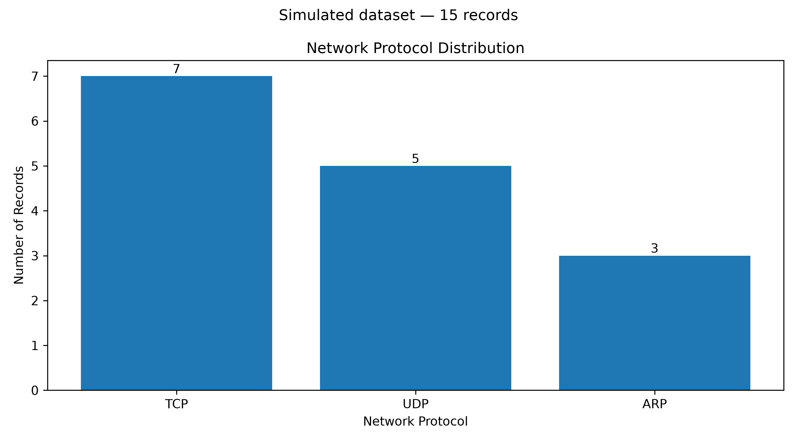

# Network Traffic Analysis Report

## 1. Project Overview

This investigation analysed a simulated network traffic dataset using a Python script.

The objective was to identify protocol distribution, frequently communicating source IP addresses, and destination IP addresses.

## 2. Tools Used

- Python
- CSV sample dataset
- Windows PowerShell

## 3. Dataset

File: sample_traffic.csv

Dataset type: Simulated sample data.

Total records analysed: 15

## 4. Findings

### Protocol Distribution

| Protocol | Records |
|---|---:|
| TCP | 7 |
| UDP | 5 |
| ARP | 3 |
| Total | 15 |

TCP represented 46.7% of the records, UDP 33.3%, and ARP 20%.

### Top Source IP Addresses

| Source IP | Records |
|---|---:|
| 192.168.1.10 | 6 |
| 192.168.1.15 | 3 |
| 192.168.1.20 | 2 |
| 192.168.1.25 | 2 |
| 192.168.1.30 | 2 |

The most frequently recorded source was 192.168.1.10.

### Top Destination IP Addresses

| Destination IP | Records |
|---|---:|
| 192.168.1.1 | 6 |
| 8.8.8.8 | 3 |
| 142.250.190.14 | 2 |
| 1.1.1.1 | 2 |
| 192.168.1.10 | 2 |

The most frequently recorded destination was 192.168.1.1.

## 5. Security Assessment

The analysis identified the most active source and destination addresses and the distribution of network protocols.

No malicious activity was confirmed by this analysis.

The results are descriptive statistics, not a full security detection assessment.

Further investigation would require packet-level information such as source and destination ports, TCP flags, packet contents, connection frequency, and a normal-traffic baseline.

## 6. Limitations

- The dataset is simulated.
- No live packet capture was performed.
- The script does not inspect packet payloads.
- The script does not identify malicious IP addresses.
- The script does not perform automated anomaly detection.

## 7. Conclusion

The Python analyser successfully processed 15 sample traffic records and produced protocol, source-address, and destination-address statistics.

This exercise demonstrates basic network traffic analysis and provides a foundation for more advanced SOC investigations.

## 8. Reproducibility

From the project folder, run:

    python Scripts/network_analyzer.py

Dataset:

    Data/sample_traffic.csv

## Protocol Distribution Chart

The chart below visualises the protocol distribution in the simulated network traffic dataset.

The dataset contained:
- TCP: 7 records
- UDP: 5 records
- ARP: 3 records

This visualisation helps demonstrate how network traffic can be summarised and presented during an initial investigation.